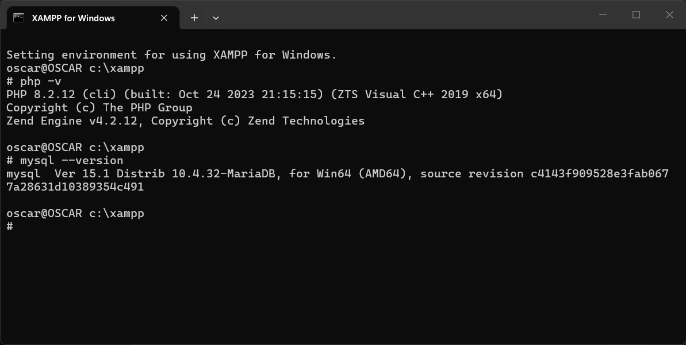
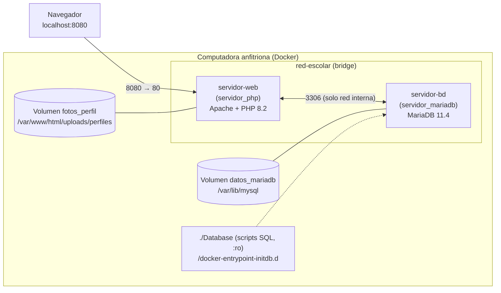
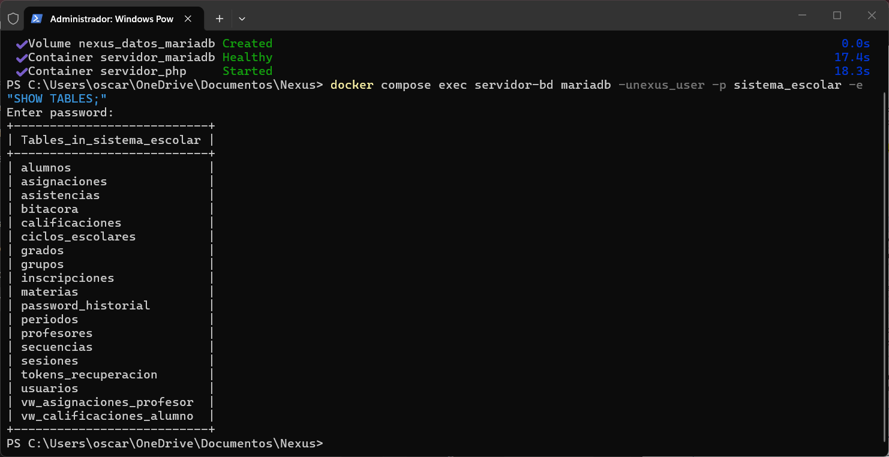
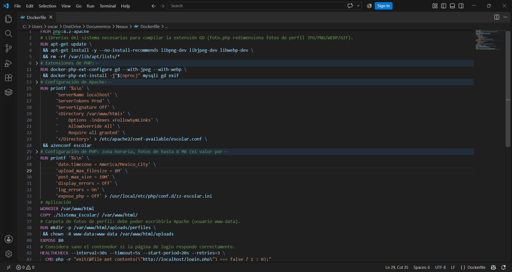
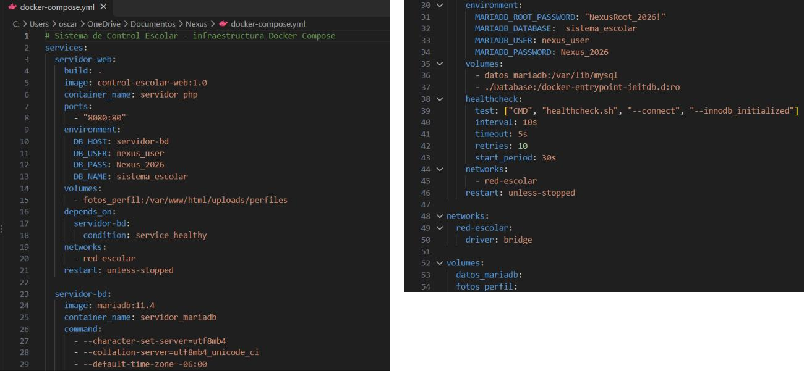
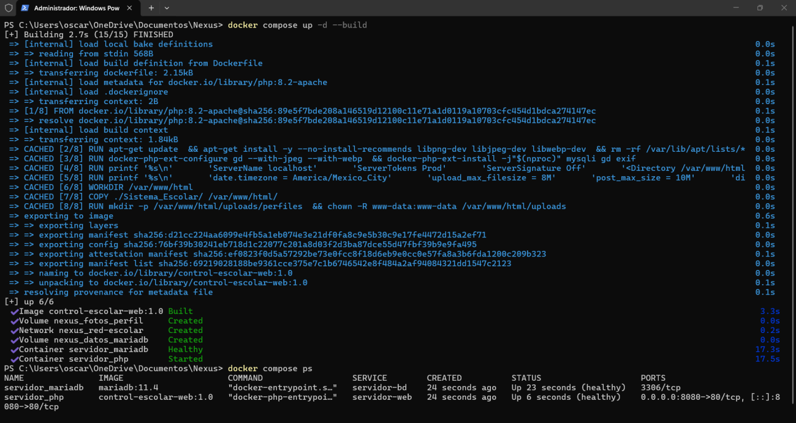
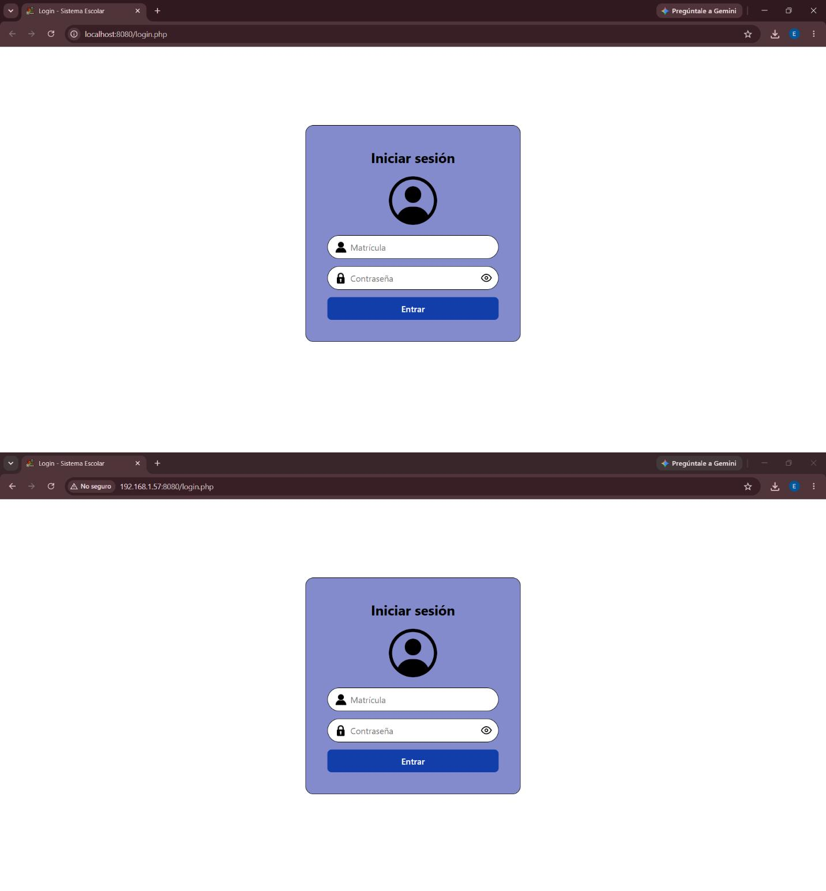
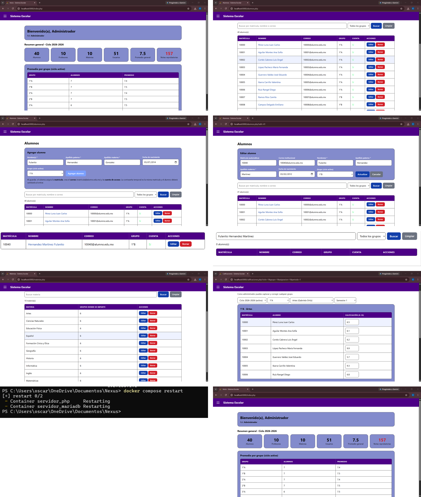
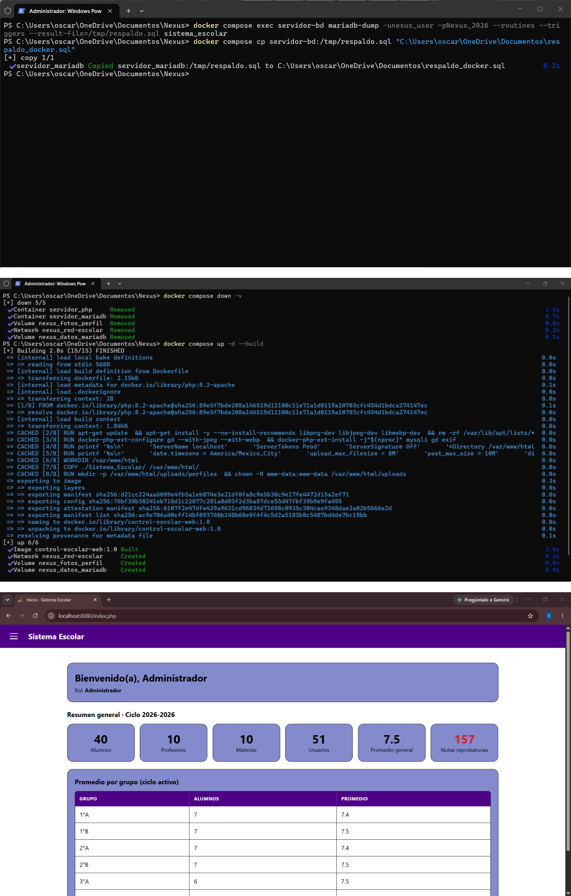

# Migración y despliegue de un Sistema de Control Escolar mediante Docker Compose

**Universidad Tecnológica de Puebla** · División de Tecnologías de la Información
**Carrera:** Ingeniería en Redes Inteligentes y Ciberseguridad
**Materia:** Automatización de la Infraestructura Digital II · **Grupo:** 10 "E"
**Profesor:** Joaquín Irigoyen Bautista

**Alumnos:**
- Erika Cristel Onofre Limón
- Oscar Emmanuel Pérez Luna

---

## Índice

1. [Introducción](#1-introducción)
2. [Diagnóstico](#2-diagnóstico)
3. [Arquitectura](#3-arquitectura)
4. [Aplicación PHP](#4-aplicación-php)
5. [Base de datos](#5-base-de-datos)
6. [Dockerfile](#6-dockerfile)
7. [Docker Compose](#7-docker-compose)
8. [Implementación (despliegue)](#8-implementación-despliegue)
9. [Pruebas de funcionamiento](#9-pruebas-de-funcionamiento)
10. [Reconstrucción de la infraestructura](#10-reconstrucción-de-la-infraestructura)
11. [Problemas encontrados y soluciones](#11-problemas-encontrados-y-soluciones)
12. [Conclusiones](#12-conclusiones)

---

## 1. Introducción

Nexus es un Sistema de Control Escolar desarrollado en PHP con base de datos MariaDB. Permite administrar alumnos, profesores, materias, ciclos escolares, grupos, asignaciones de materias a profesores, calificaciones, asistencias y boletas. Cuenta además con usuarios de distintos roles (administrador, profesor y alumno), una bitácora de auditoría y la gestión de contraseñas.

Originalmente el sistema funcionaba con servicios instalados directamente en Windows mediante XAMPP (Apache, PHP y MariaDB). El objetivo de este proyecto fue migrarlo a una infraestructura de contenedores Docker, de modo que pueda ejecutarse en cualquier computadora con Docker sin instalar PHP, Apache ni MariaDB de forma individual. Toda la infraestructura (servidor web, base de datos, red y almacenamiento) se define en archivos y puede reconstruirse desde cero con un solo comando.

**Módulos principales de la aplicación (carpeta `Sistema_Escolar/`):**

| Módulo | Archivo |
|---|---|
| Inicio y cierre de sesión | `login.php`, `logout.php` |
| Alumnos | `alumnos.php` |
| Profesores | `profesores.php` |
| Materias | `materias.php` |
| Ciclos escolares y periodos | `ciclos.php` |
| Asignaciones (grupo, materia y profesor) | `asignaciones.php` |
| Calificaciones y boleta | `calificaciones.php`, `boleta.php` |
| Asistencias | `asistencias.php` |
| Usuarios y cambio de contraseña | `usuarios.php`, `cambiar_password.php` |
| Bitácora de auditoría | `bitacora.php` |
| Fotos de perfil | `foto.php` |

---

## 2. Diagnóstico

### 2.1 Tecnologías y versiones utilizadas

Antes de migrar se identificaron los componentes del sistema que funcionaba en Windows:

| Pregunta | Respuesta |
|---|---|
| ¿Qué versión de PHP utiliza el sistema? | PHP 8.2.12 |
| ¿Qué versión de MariaDB utiliza? | MariaDB 10.4.32 |
| ¿Qué servidor web utiliza? | Apache (XAMPP) |
| ¿Qué extensiones de PHP requiere? | `mysqli` (conexión a MariaDB), `gd` (redimensionar fotos de perfil) y `exif` (leer la orientación de las fotos JPG). También usa `mbstring` y las funciones de contraseñas (`password_hash` y `password_verify`), que ya vienen incluidas en la imagen oficial `php:8.2-apache`. |
| ¿Cuál es el nombre de la base de datos? | `sistema_escolar` |
| ¿Cuántas tablas contiene? | 17 tablas, además de 2 vistas, 5 triggers y 19 llaves foráneas |
| ¿Qué archivo realiza la conexión con MariaDB? | `Sistema_Escolar/config/db.php`, que utiliza `new mysqli(...)` |
| ¿Qué información contiene el respaldo SQL? | `01_sistema_escolar.sql` contiene la estructura completa (tablas, llaves, vistas, índices y triggers) y el usuario administrador inicial. `datos.sql` contiene los datos de prueba (ver sección 5). |



*Figura 1. Versiones de PHP y MariaDB del sistema original en Windows (XAMPP).*

### 2.2 Respaldo de la aplicación y de la base de datos

Antes de comenzar la migración se realizó una copia de seguridad en la carpeta Documentos de OneDrive. La carpeta de la aplicación se comprimió en un archivo ZIP y se copió el archivo SQL original de la base de datos (`C:\xampp\mysql\bin\sistema_escolar.sql`):

```powershell
Compress-Archive -Path "C:\xampp\htdocs\Sistema_Escolar" -DestinationPath "C:\Users\oscar\OneDrive\Documentos\respaldo_app_sistema_escolar.zip"

Copy-Item "C:\xampp\mysql\bin\sistema_escolar.sql" "C:\Users\oscar\OneDrive\Documentos\sistema_escolar_original.sql"
```

---

## 3. Arquitectura

La infraestructura está formada por dos contenedores conectados mediante una red privada y por dos volúmenes persistentes. El usuario accede desde el navegador al puerto 8080 del equipo, que Docker redirige al puerto 80 del contenedor web. Este se comunica con el contenedor de MariaDB a través de la red interna, sin exponer la base de datos al exterior.



*Figura 2. Diagrama de la infraestructura Docker del sistema Nexus.*

| Componente | Función |
|---|---|
| `servidor-web` | Contenedor Apache + PHP 8.2 con la aplicación. Es la única parte publicada al exterior (puerto 8080). |
| `servidor-bd` | Contenedor MariaDB 11.4. No publica puertos: solo es accesible desde la red Docker. |
| `red-escolar` | Red privada tipo *bridge* que permite a PHP encontrar a MariaDB por el nombre `servidor-bd`. |
| `datos_mariadb` | Volumen que guarda la base de datos para que los datos sobrevivan al reinicio o a la eliminación de los contenedores. |
| `fotos_perfil` | Volumen que guarda las fotos de perfil subidas por los usuarios. |
| `Database/` | Carpeta con los scripts SQL de inicialización, montada en modo solo lectura (`:ro`). |

---

## 4. Aplicación PHP

### 4.1 Estructura de archivos

```
PROYECTO_CONTROL_ESCOLAR/
├── Dockerfile
├── docker-compose.yml
├── DOCUMENTACION.md
├── Sistema_Escolar/              ← aplicación PHP
│   ├── index.php, login.php, logout.php
│   ├── alumnos.php, profesores.php, materias.php, ciclos.php
│   ├── asignaciones.php, calificaciones.php, asistencias.php
│   ├── boleta.php, bitacora.php, usuarios.php, cambiar_password.php
│   ├── mis_grupos.php, mi_grupo.php, foto.php
│   ├── config/    (db.php y .htaccess)
│   ├── includes/  (auth.php, funciones.php, header.php, footer.php)
│   ├── css/  js/  img/
│   └── uploads/   (fotos de perfil, protegida con .htaccess)
├── Database/
│   ├── 01_sistema_escolar.sql
│   └── datos.sql
└── evidencias/
    ├── 01_diagnostico.png
    ├── 02_dockerfile.png
    ├── 03_docker_compose.png
    ├── 04_contenedores.png
    ├── 05_base_datos.png
    ├── 06_sistema_funcionando.png
    ├── 07_pruebas.png
    └── 08_reconstruccion.png
```

### 4.2 Modificaciones realizadas

**Archivo de conexión (`Sistema_Escolar/config/db.php`).** Antes la conexión estaba fija para XAMPP (`localhost`, usuario `root` y sin contraseña). Ahora toma los datos desde variables de entorno definidas en Docker Compose:

| Antes (Windows) | Ahora (Docker) | Explicación |
|---|---|---|
| `localhost` | `servidor-bd` (mediante `DB_HOST`) | Dentro de Docker, `localhost` sería el propio contenedor web. El nombre del servicio `servidor-bd` lo resuelve el DNS interno de la red Docker. |
| `root` sin contraseña | `nexus_user` con contraseña | Se usa un usuario con privilegios únicamente sobre `sistema_escolar`, en lugar de `root`. |
| Valores escritos en el código | Variables de entorno | Evita credenciales fijas en el código y permite cambiarlas desde `docker-compose.yml`. |

```php
$DB_HOST = getenv('DB_HOST') ?: 'db';
$DB_USER = getenv('DB_USER') ?: 'nexus_user';
$DB_PASS = getenv('DB_PASS') ?: 'Nexus_2026';
$DB_NAME = getenv('DB_NAME') ?: 'sistema_escolar';
$conn = new mysqli($DB_HOST, $DB_USER, $DB_PASS, $DB_NAME);
```

Los valores por defecto del código solo se utilizan si las variables de entorno no existen; en Docker siempre se usan las definidas en `docker-compose.yml`.

Durante la migración se incorporaron además las siguientes mejoras:

- **Datos de prueba automáticos.** Se agregó el archivo `datos.sql`, que llena las tablas con alumnos, profesores, calificaciones y demás registros. Así, cuando los contenedores están listos, la aplicación ya contiene información y puede probarse de inmediato.
- **Contraseñas protegidas.** En la base de datos solo se almacena el *hash* de las contraseñas, nunca el texto original. De esta forma, si alguien obtuviera acceso a la base de datos, las contraseñas serían mucho más difíciles de descifrar.
- **Cierre de sesión seguro.** Antes, al cerrar sesión y presionar la flecha «atrás» del navegador, se mostraba de nuevo la página como si la sesión siguiera activa. Ahora las páginas no se guardan en caché y el sistema exige iniciar sesión nuevamente.
- **Otras medidas de seguridad.** Los errores de conexión se registran en el log del contenedor y no en pantalla, se envían cabeceras de seguridad HTTP, las sesiones usan cookies `httponly` y `samesite`, y las carpetas `config/`, `includes/` y `uploads/` se protegen con `.htaccess`.

---

## 5. Base de datos

### 5.1 Tablas

La base de datos `sistema_escolar` contiene **17 tablas**:

| Grupo | Tablas |
|---|---|
| Personas | `alumnos`, `profesores`, `usuarios` |
| Catálogos académicos | `ciclos_escolares`, `periodos`, `grados`, `grupos`, `materias` |
| Operación escolar | `asignaciones`, `inscripciones`, `calificaciones`, `asistencias` |
| Seguridad y auditoría | `bitacora`, `sesiones`, `tokens_recuperacion`, `password_historial` |
| Control de matrículas | `secuencias` |

Además incluye:

- **2 vistas:** `vw_calificaciones_alumno` y `vw_asignaciones_profesor`.
- **5 triggers:** `trg_calif_insert`, `trg_calif_update` y `trg_calif_delete` registran en la bitácora todo cambio de calificaciones; `trg_bitacora_no_update` y `trg_bitacora_no_delete` impiden modificar o borrar la bitácora.
- **19 llaves foráneas**, por ejemplo `calificaciones → inscripciones`, `calificaciones → asignaciones`, `inscripciones → alumnos` y `asignaciones → grupos, materias y profesores`.
- Índices adicionales para acelerar las búsquedas frecuentes.



*Figura 3. Tablas y vistas creadas automáticamente en MariaDB al iniciar el contenedor.*

### 5.2 Archivos SQL y orden de ejecución

La carpeta `Database/` se monta en `/docker-entrypoint-initdb.d`. La imagen oficial de MariaDB ejecuta los archivos en orden alfabético:

| Orden | Archivo | Contenido |
|---|---|---|
| 1 | `01_sistema_escolar.sql` | Estructura completa: tablas, llaves, vistas, índices, secuencias de matrícula, usuario administrador inicial y triggers. |
| 2 | `datos.sql` | Datos de prueba: 10 profesores, 1 ciclo escolar con 2 semestres, 3 grados, 6 grupos, 10 materias, 40 alumnos con sus inscripciones, cuentas de acceso y calificaciones de ambos semestres. |

El orden respeta las dependencias entre tablas: primero se crea la estructura (archivo `01_`) y después se insertan los datos (`datos.sql`).

### 5.3 Adaptaciones hechas al respaldo SQL

| Cambio | Motivo |
|---|---|
| Se eliminó `DROP DATABASE IF EXISTS ...` | Era peligroso: borraba toda la base de datos. |
| Se eliminaron `CREATE DATABASE` y `USE` | Docker Compose ya crea la base (`MARIADB_DATABASE`) y la imagen ejecuta los scripts sobre ella. |
| Se conservaron tablas, vistas, triggers y administrador inicial | No requerían cambios. |

### 5.4 Cuentas de acceso para pruebas

| Rol | Usuario | Contraseña inicial |
|---|---|---|
| Administrador | `1000` | `Huevito123?` |
| Profesores | `50000` a `50009` | La misma matrícula |
| Alumnos | `10000` a `10039` | La misma matrícula |

Todas las cuentas tienen activada la opción `debe_cambiar_password`, por lo que el sistema obliga a cambiar la contraseña en el primer inicio de sesión. Las contraseñas se guardan únicamente como *hash* (bcrypt). Estas credenciales son exclusivas del laboratorio.

---

## 6. Dockerfile

El `Dockerfile` construye la imagen del servidor web a partir de `php:8.2-apache`. Cada instrucción cumple una función específica:

| Instrucción | Qué hace | Por qué es necesaria |
|---|---|---|
| `FROM php:8.2-apache` | Usa como base una imagen con Apache y PHP 8.2. | Sustituye la instalación de XAMPP. |
| `RUN apt-get install ... libpng-dev libjpeg-dev libwebp-dev` | Instala librerías del sistema. | Son necesarias para compilar la extensión GD (`foto.php` procesa fotos JPG, PNG, WEBP y GIF). |
| `docker-php-ext-configure gd` y `docker-php-ext-install mysqli gd exif` | Configura e instala las extensiones de PHP. | `mysqli` conecta con MariaDB, `gd` redimensiona imágenes y `exif` lee la orientación de las fotos. |
| `RUN printf ... escolar.conf` y `a2enconf escolar` | Crea y activa una configuración de Apache con `AllowOverride All` y `Options -Indexes`. | Sin `AllowOverride All`, Apache ignora los `.htaccess` y las carpetas protegidas quedarían accesibles. `-Indexes` impide listar carpetas y se oculta la versión de Apache. |
| `RUN printf ... zz-escolar.ini` | Crea la configuración de PHP. | Define la zona horaria (`America/Mexico_City`), sube el límite de fotos a 8 MB (por defecto son 2 MB) y envía los errores al log en lugar de mostrarlos. |
| `WORKDIR /var/www/html` | Define el directorio de trabajo. | Es la carpeta pública de Apache. |
| `COPY ./Sistema_Escolar/ /var/www/html/` | Copia la aplicación a la imagen. | La aplicación queda dentro de la imagen. |
| `RUN mkdir -p ... && chown -R www-data ...` | Crea la carpeta de fotos y da permisos a Apache. | Apache se ejecuta como `www-data` y necesita escribir las fotos de perfil. |
| `EXPOSE 80` | Documenta el puerto del contenedor. | Es informativo; la publicación real se hace en Docker Compose. |
| `HEALTHCHECK ...` | Comprueba cada 30 segundos que `login.php` responda. | Permite saber si el contenedor está sano (`docker compose ps`). |



*Figura 4. Dockerfile del servidor web.*

---

## 7. Docker Compose

El archivo `docker-compose.yml` define dos servicios, una red y dos volúmenes.

### 7.1 Servicio `servidor-web`

| Configuración | Explicación |
|---|---|
| `build: .` | Construye la imagen con el `Dockerfile` de la carpeta actual. |
| `image: control-escolar-web:1.0` | Nombre y versión de la imagen construida. |
| `container_name: servidor_php` | Nombre fijo del contenedor. |
| `ports: "8080:80"` | Publica el puerto 80 del contenedor en el 8080 del equipo (`http://localhost:8080`). |
| `environment: DB_HOST, DB_USER, DB_PASS, DB_NAME` | Variables que lee `config/db.php`. Deben coincidir con las de MariaDB. |
| `volumes: fotos_perfil` | Las fotos subidas persisten aunque se recree el contenedor. |
| `depends_on` con `condition: service_healthy` | PHP no arranca hasta que MariaDB esté lista. Evita errores de conexión al iniciar. |
| `networks: red-escolar` | Conecta el servicio a la red privada. |
| `restart: unless-stopped` | Reinicia el contenedor si falla o si Docker se reinicia. |

### 7.2 Servicio `servidor-bd`

| Configuración | Explicación |
|---|---|
| `image: mariadb:11.4` | Imagen oficial de MariaDB con versión fija. |
| `command: --character-set-server=utf8mb4 ...` | Codificación UTF-8 completa (acentos y ñ) y zona horaria de México (`-06:00`). |
| `MARIADB_ROOT_PASSWORD` | Contraseña del usuario `root` (solo laboratorio). |
| `MARIADB_DATABASE: sistema_escolar` | La imagen crea esta base de datos automáticamente al inicializar. |
| `MARIADB_USER` y `MARIADB_PASSWORD` | La imagen crea el usuario `nexus_user` con permisos sobre `sistema_escolar`. Coinciden con `DB_USER` y `DB_PASS` del servicio web. |
| `volumes: datos_mariadb:/var/lib/mysql` | Persistencia de la base de datos. |
| `volumes: ./Database:/docker-entrypoint-initdb.d:ro` | Monta los scripts SQL de inicialización en solo lectura. |
| `healthcheck` | Ejecuta `healthcheck.sh` cada 10 segundos para verificar que MariaDB acepta conexiones y que InnoDB está inicializado. |
| `networks: red-escolar` | Misma red que el servicio web. No publica puertos al exterior. |

### 7.3 Red y volúmenes

| Elemento | Explicación |
|---|---|
| `red-escolar` (bridge) | Red privada; los contenedores se encuentran por el nombre de su servicio. |
| `datos_mariadb` | Volumen administrado por Docker con los datos de MariaDB. |
| `fotos_perfil` | Volumen administrado por Docker con las fotos de perfil. |



*Figura 5. Archivo `docker-compose.yml`: servicio web (izquierda) y servicio de base de datos, red y volúmenes (derecha).*

---

## 8. Implementación (despliegue)

**Requisito:** Docker Desktop (o Docker Engine con el plugin Compose). Desde la carpeta principal del proyecto, la que contiene `docker-compose.yml`, se ejecutan los siguientes comandos:

```bash
# 1. Construir la imagen e iniciar los servicios
docker compose up -d --build

# 2. Verificar los contenedores (deben aparecer como 'healthy')
docker compose ps
```



*Figura 6. Construcción de la imagen, creación de la infraestructura y contenedores en estado `healthy`.*

Una vez iniciados los contenedores, la aplicación se abre en el navegador desde:

- La misma computadora: <http://localhost:8080>
- Otra computadora de la red local: `http://192.168.1.57:8080`



*Figuras 7 y 8. Sistema Nexus funcionando en Docker, accedido desde `localhost:8080` (arriba) y desde otra computadora de la red local, `192.168.1.57:8080` (abajo).*

---

## 9. Pruebas de funcionamiento

Las pruebas se realizaron sobre la aplicación real ejecutándose en Docker. Todas se completaron satisfactoriamente.

| Núm. | Prueba | Resultado esperado | Resultado |
|---|---|---|---|
| 1 | Acceder al sistema | Página principal visible | ✔ Correcto |
| 2 | Iniciar sesión (usuario 1000) | Acceso correcto | ✔ Correcto |
| 3 | Consultar alumnos | Información visible | ✔ Correcto |
| 4 | Registrar alumno | Registro almacenado | ✔ Correcto |
| 5 | Modificar alumno | Cambios guardados | ✔ Correcto |
| 6 | Eliminar registro de prueba | Registro eliminado | ✔ Correcto |
| 7 | Consultar materias | Información visible | ✔ Correcto |
| 8 | Consultar calificaciones | Datos relacionados visibles | ✔ Correcto |
| 9 | Reiniciar contenedores (`docker compose restart`) | El sistema sigue funcionando | ✔ Correcto |
| 10 | Consultar información después del reinicio | Los datos permanecen | ✔ Correcto |

**Pruebas adicionales propias de la aplicación:**

| Prueba | Resultado esperado | Resultado |
|---|---|---|
| Subir una foto de perfil y reiniciar los contenedores | La foto permanece (volumen `fotos_perfil`) | ✔ Correcto |
| Cambiar una calificación y revisar la bitácora | Aparece el registro (trigger de auditoría) | ✔ Correcto |
| Abrir `http://localhost:8080/config/db.php` | Acceso denegado (403) por `.htaccess` | ✔ Correcto |

### Evidencias de las pruebas



*Figura 9 a 18 (de izquierda a derecha y de arriba abajo):*

- *Prueba 2: inicio de sesión como administrador y panel principal con el resumen general.*
- *Prueba 3: consulta de alumnos (40 registros iniciales).*
- *Prueba 4: registro de un nuevo alumno.*
- *Prueba 5: edición del alumno registrado (el contador pasó a 41) y alumno con los datos modificados.*
- *Prueba 6: tras eliminar el registro de prueba, la búsqueda ya no devuelve resultados.*
- *Prueba 7: consulta de materias.*
- *Prueba 8: consulta de calificaciones por grupo, materia y semestre.*
- *Prueba 9: reinicio de los contenedores con `docker compose restart`.*
- *Prueba 10: después del reinicio, los datos permanecen (40 alumnos, 10 profesores, 10 materias).*

---

## 10. Reconstrucción de la infraestructura

Esta es la prueba principal del proyecto: eliminar toda la infraestructura y reconstruirla únicamente con los archivos entregados.

**1. Respaldar los datos importantes.** Se generó un respaldo de la base de datos dentro del contenedor y se copió a la computadora:

```powershell
docker compose exec servidor-bd mariadb-dump -unexus_user -pNexus_2026 --routines --triggers --result-file=/tmp/respaldo.sql sistema_escolar

docker compose cp servidor-bd:/tmp/respaldo.sql "C:\Users\oscar\OneDrive\Documentos\respaldo_docker.sql"
```

**2. Detener y eliminar contenedores, red y volúmenes**, y **3. reconstruir los servicios:**

```bash
docker compose down -v
docker compose up -d --build
```

**4.** Esperar a que MariaDB termine la inicialización (`docker compose logs -f servidor-bd` y `docker compose ps` hasta que aparezca `healthy`). **5.** Acceder a <http://localhost:8080> y **6.** comprobar que existen las tablas y los registros iniciales.



*Figuras 19 a 21. Respaldo de la base de datos copiado a la computadora; eliminación de la infraestructura (`down -v`) y reconstrucción desde cero (`up -d --build`); y sistema funcionando después de la reconstrucción, con los registros iniciales restaurados.*

**Resultado:** la reconstrucción se realizó correctamente. El respaldo se generó sin problemas, las tablas se volvieron a crear a partir de los scripts SQL y los datos importantes no se perdieron.

### ¿Por qué los scripts SQL se ejecutan solo cuando se crea el volumen por primera vez?

La imagen oficial de MariaDB incluye un script de entrada (`docker-entrypoint.sh`). Al iniciar el contenedor revisa si el directorio de datos (`/var/lib/mysql`) está vacío:

- **Si está vacío** (primer arranque o después de `docker compose down -v`), la imagen inicializa MariaDB, crea la base de datos, el usuario y las contraseñas indicadas en las variables `MARIADB_*`, y ejecuta en orden alfabético los archivos `.sql`, `.sql.gz` y `.sh` de `/docker-entrypoint-initdb.d`.
- **Si ya contiene datos** (el volumen `datos_mariadb` persiste entre reinicios), la imagen omite la inicialización y no ejecuta los scripts, para no sobrescribir ni duplicar información.

Por eso `docker compose down` (sin `-v`) conserva los datos y no vuelve a ejecutar los scripts, mientras que `docker compose down -v` elimina el volumen y provoca una nueva inicialización. Por la misma razón, si se modifica un archivo SQL después del primer arranque, el cambio no se aplica hasta recrear el volumen.

---

## 11. Problemas encontrados y soluciones

| Problema | Causa | Solución |
|---|---|---|
| El respaldo SQL incluía `DROP DATABASE`, `CREATE DATABASE` y `USE` | Eran instrucciones de la instalación original, peligrosas o incompatibles con la inicialización automática. | Se eliminaron del script; la base de datos la crea `MARIADB_DATABASE`. |
| La aplicación intentaba conectarse a `localhost` | La conexión estaba pensada para XAMPP. | Se leyeron los datos de conexión desde variables de entorno (`DB_HOST=servidor-bd`). |
| Las carpetas `config/`, `includes/` y `uploads/` podían quedar accesibles | Apache ignora los `.htaccess` si `AllowOverride` no está activo. | Se configuró `AllowOverride All` en el Dockerfile. |
| No se podían subir fotos de perfil | Permisos de la carpeta `uploads` y límite de 2 MB de PHP. | `chown www-data` en el Dockerfile, `upload_max_filesize = 8M` y volumen `fotos_perfil`. |
| PHP podía iniciar antes de que MariaDB estuviera lista | Un `depends_on` simple solo espera a que el contenedor inicie, no a que el servicio esté listo. | `healthcheck` en MariaDB y `depends_on` con `condition: service_healthy`. |
| Error 1045 (*Access denied*) al respaldar con `mariadb-dump` | Se usó el usuario `root` con la contraseña de `nexus_user`. Además, el operador `>` de PowerShell guarda el archivo con una codificación que daña los acentos. | Se usó `nexus_user`, la opción `--result-file` dentro del contenedor y `docker compose cp` para copiar el archivo. |

---

## 12. Conclusiones

Con este proyecto logramos migrar nuestro Sistema de Control Escolar, que originalmente dependía de XAMPP en Windows, a una infraestructura completa basada en contenedores Docker. La aplicación PHP y la base de datos MariaDB funcionan ahora en contenedores independientes, se comunican a través de una red privada y conservan su información gracias a los volúmenes. Comprobamos que el sistema funciona con todas sus funciones principales, que los datos permanecen después de reiniciar y que toda la infraestructura puede eliminarse y reconstruirse desde cero con solo dos comandos.

Uno de los mayores aprendizajes fue entender cómo se inicializa la base de datos. Aprendimos que los scripts SQL se ejecutan únicamente cuando el volumen está vacío, y que por eso hay una diferencia importante entre detener los contenedores y eliminar los volúmenes con `down -v`. También entendimos por qué la aplicación ya no debe conectarse a `localhost` sino al nombre del servicio `servidor-bd`, y por qué es necesario que MariaDB esté sana antes de que PHP arranque. Resolver estos detalles, además de adaptar el respaldo SQL y los permisos de la carpeta de fotos, nos ayudó a comprender mejor cómo se comunican los distintos componentes.

Frente a la instalación tradicional, Docker nos ofrece ventajas claras: cualquier persona puede ejecutar el proyecto en otra computadora con solo tener Docker instalado, las versiones de PHP y MariaDB son siempre las mismas, el entorno queda aislado del resto del equipo y es muy fácil de reconstruir si algo falla. Esto reduce errores de configuración y ahorra mucho tiempo en la instalación.

Como mejoras a futuro, nos gustaría guardar las contraseñas en un archivo `.env` fuera del repositorio, automatizar los respaldos de la base de datos y habilitar HTTPS. En general, este proyecto nos permitió aplicar en un caso real los conocimientos de contenedores, Dockerfile, Docker Compose, redes y volúmenes, y nos dejó una base sólida para desplegar otras aplicaciones de la misma manera.
